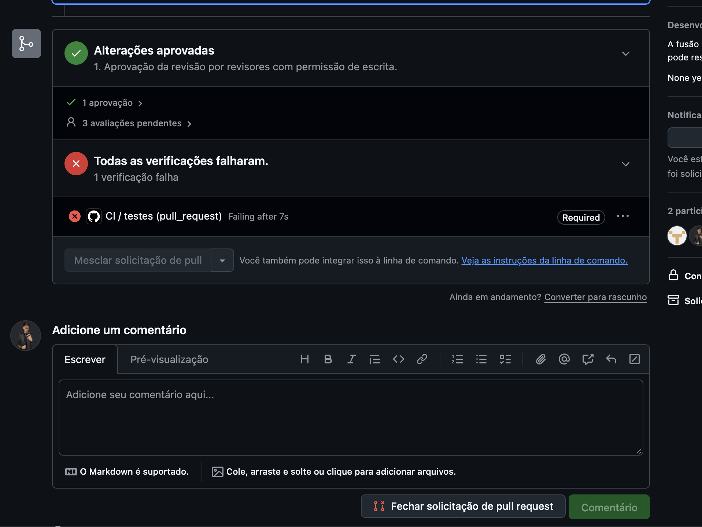
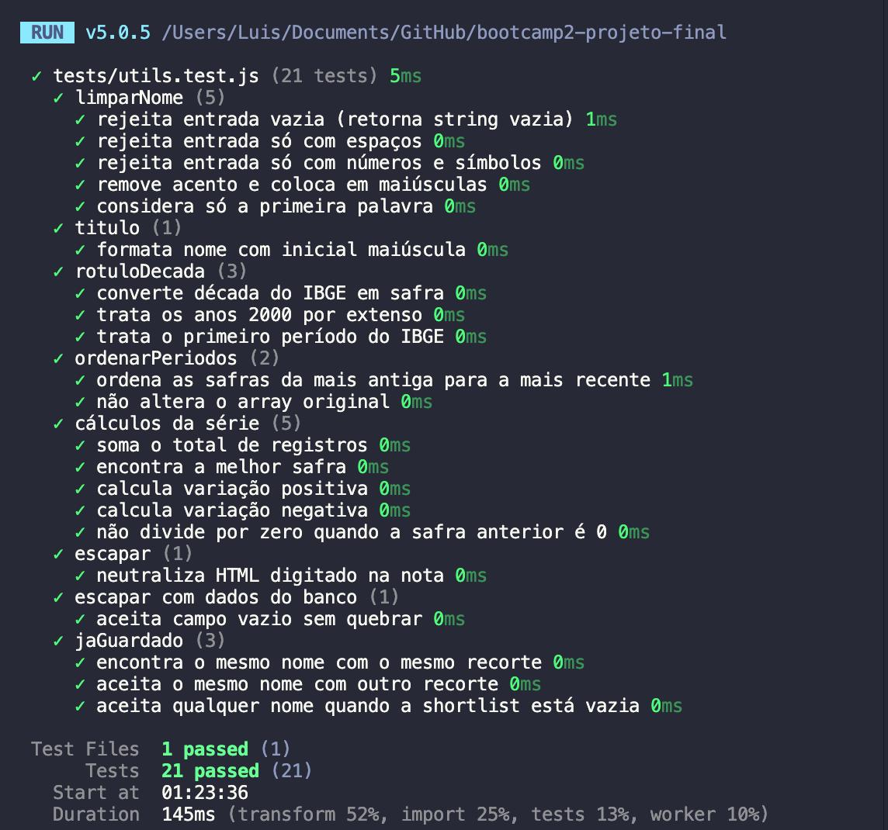
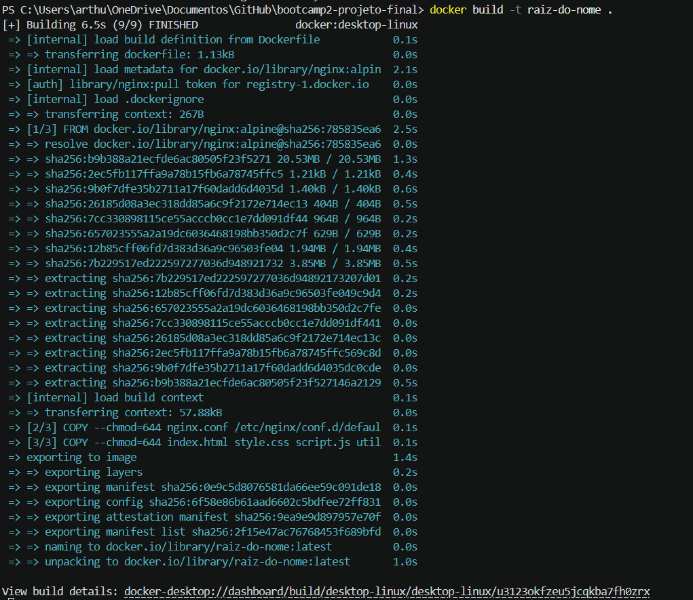
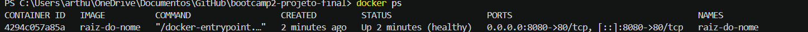
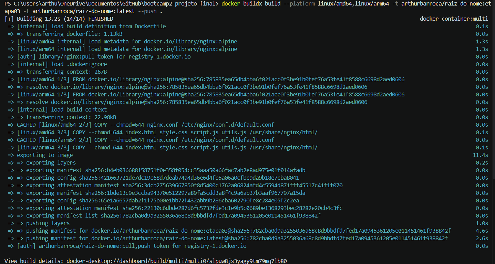

# Raiz do Nome

> Quem tem seu nome? Descubra a raiz, a safra e a geração dele no Brasil, com dados oficiais do Censo IBGE.

Projeto final do **Bootcamp II** (ADS · CEUB · 2026/2), Etapa 03: fluxo profissional com branches, Pull Requests, integração contínua e imagem pública no Docker Hub.

## Colaboradores & Funções
| Nome | RA | GitHub User | Função | Link PR |
| --- | --- | --- | --- | --- |
| Alex Machado Generoso Perissê | 22610844 | [@AL3XP3RISSE](https://github.com/AL3XP3RISSE) | Persistência | [#8](https://github.com/AL3XP3RISSE/bootcamp2-projeto-final/pull/8) |
| Arthur Bradley Barroca | 22603901 | [@Arthur-Bradley-Barroca](https://github.com/Arthur-Bradley-Barroca) | DockerHub | [#10](https://github.com/AL3XP3RISSE/bootcamp2-projeto-final/pull/10) |
| Giovanna Martins da Silva | 22610329 | [@giihmartins](https://github.com/giihmartins) | Frontend | [#6](https://github.com/AL3XP3RISSE/bootcamp2-projeto-final/pull/6) |
| Glauber Oliveira | 22601400 | [@glauberoliveirabr](https://github.com/glauberoliveirabr) | Teste JavaScript | [#5](https://github.com/AL3XP3RISSE/bootcamp2-projeto-final/pull/5) · [#12](https://github.com/AL3XP3RISSE/bootcamp2-projeto-final/pull/12) |
| Luis Ernane Oliveira de Alencar | 22601006 | [@luisernane-cell](https://github.com/luisernane-cell) | Aplicação da API | [#7](https://github.com/AL3XP3RISSE/bootcamp2-projeto-final/pull/7) · [#11](https://github.com/AL3XP3RISSE/bootcamp2-projeto-final/pull/11) |

| PR | O que entregou |
| --- | --- |
| #5 | Funções puras em `utils.js`, testes com Vitest, workflow de CI, Dockerfile |
| #6 | Rodapé com a equipe e a Etapa 03 |
| #7 | Tempo limite e cache nas consultas ao IBGE |
| #8 | Proteção contra HTML injetado e bloqueio de duplicados na Próxima geração |
| #10 | Configuração do Nginx, healthcheck e publicação no Docker Hub |
| #11 | Correção do import duplicado (ver [Problema de integração](#problema-de-integração)) |
| #12 | Checagem de sintaxe do JavaScript no CI |

## Aplicação
- **Descrição da Aplicação:** o Raiz do Nome é um explorador interativo de nomes brasileiros. A pessoa digita um nome e descobre quantos brasileiros o têm, em que década ele surgiu (a **raiz**), qual foi a década de pico (a **melhor safra**) e se ele está crescendo ou caindo na **geração atual**. Também dá para comparar dois nomes e guardar candidatos na **Próxima geração**, uma shortlist de nomes de bebê salva na nuvem.
- **API Escolhida:** [API de Nomes do IBGE](https://servicodados.ibge.gov.br/api/docs/nomes?versao=2) (Censo Demográfico 2010), pública e sem chave. O IBGE só divulga nomes com 20 ou mais ocorrências por década.
- **Banco de Dados Utilizado:** [Supabase](https://supabase.com) (PostgreSQL), tabela `proxima_geracao`.

### Funcionalidades
- Busca com contador animado e frase que conta a história do nome
- Gráfico de safras (registros por década de nascimento)
- Comparação de dois nomes, com veredito de qual é mais comum
- Filtros por sexo e por estado (UF)
- Atalhos com os 10 nomes mais comuns do Brasil
- **Próxima geração:** guardar um nome com tag e nota, listar, reabrir a pesquisa e excluir, sem duplicados
- Mensagens de erro amigáveis (campo vazio, nome sem registros, IBGE lento ou fora do ar, banco fora do ar)
- Respeito à preferência de movimento reduzido do sistema (`prefers-reduced-motion`)

### Como a API é usada
| Dado | Endpoint |
| --- | --- |
| Frequência por década | `GET /api/v2/censos/nomes/{nome}` (com `?sexo=` e `?localidade=`; na comparação, os dois nomes vão separados por `\|`) |
| Top 10 do Brasil | `GET /api/v2/censos/nomes/ranking?localidade=BR` |
| Lista de estados | `GET /api/v1/localidades/estados?orderBy=nome` |

Todas as consultas passam por uma única função, `consultarIBGE`, com tempo limite de 10 segundos e cache das respostas durante a visita.

### Sobre o banco
O app usa a **chave publicável** do Supabase, feita para ficar no frontend. A tabela tem RLS liberado para leitura, inclusão e exclusão por visitantes anônimos.

**Limitação conhecida:** como não há login, a shortlist é **compartilhada**: todos os visitantes veem e podem excluir os mesmos nomes. Por isso, todo texto vindo do banco passa por `escapar()` antes de ir para a tela.

### Tecnologias
HTML semântico · Tailwind CSS v4 (CDN) · CSS próprio · JavaScript puro (ES modules) · Supabase · Vitest · GitHub Actions · Docker (Nginx Alpine)

### Estrutura
```
├── index.html             # estrutura da página
├── style.css              # estilos próprios
├── script.js              # interface, API do IBGE e Supabase
├── utils.js               # funções puras (testadas)
├── tests/utils.test.js    # testes automatizados (Vitest)
├── .github/workflows/ci.yml
├── Dockerfile
├── nginx.conf
└── docsevidencias/        # prints do fluxo
```

## Como rodar com Docker

Imagem pública no Docker Hub: [arthurbarroca/raiz-do-nome](https://hub.docker.com/r/arthurbarroca/raiz-do-nome)

```bash
docker run -d -p 8080:80 --name raiz-do-nome arthurbarroca/raiz-do-nome:etapa03
```

Depois, abra http://localhost:8080. Para parar e remover o container:

```bash
docker rm -f raiz-do-nome
```

A imagem usa Nginx Alpine com compressão gzip, cabeçalhos de segurança e healthcheck, e roda em computadores Intel e Apple Silicon.

Para gerar a imagem a partir do código:

```bash
docker build -t raiz-do-nome .
```

## Testes

Os testes cobrem as funções puras do `utils.js`: limpeza do nome digitado, rótulo das décadas, ordenação das safras, totais, melhor safra, variação percentual, proteção contra HTML injetado e bloqueio de duplicados na Próxima geração. São **21 testes** com [Vitest](https://vitest.dev).

Para rodar na sua máquina (precisa de Node.js 22.12 ou mais recente):

```bash
npm ci
```

```bash
npm test
```

### Integração contínua
O workflow `.github/workflows/ci.yml` roda em todo Pull Request para a `main` e em todo push nela, em duas etapas:

1. **Conferir sintaxe do JavaScript:** `node --check` no `script.js` e no `utils.js`
2. **Rodar testes:** `npm test`

O job se chama **`testes`** e é um **status check obrigatório**. A `main` só aceita merge por Pull Request, com aprovação de um revisor e o check verde.

## Evidências

### Teste de fogo: merge bloqueado pelo CI
No [PR #13](https://github.com/AL3XP3RISSE/bootcamp2-projeto-final/pull/13), quebramos de propósito o teste `converte década do IBGE em safra` (esperando `"anos 80"` no lugar de `"anos 90"`). Mesmo com uma aprovação, o check obrigatório `CI / testes` falhou e o botão de merge ficou bloqueado. O PR foi fechado sem merge.



### Testes passando
21 testes passando depois do PR de persistência:



### Docker
Build da imagem:



Container rodando e saudável:



Publicação no Docker Hub para Intel (amd64) e Apple Silicon (arm64), com as tags `etapa03` e `latest`:



### Problema de integração
Não tivemos conflito de merge no Git, mas tivemos um problema de integração que o CI não pegou na hora.

- **O que aconteceu:** no PR #8, o novo `import` com `jaGuardado` foi colado **ao lado** do `import` antigo, em vez de substituí-lo. O `script.js` passou a importar as mesmas funções duas vezes, e o navegador parou de executar o arquivo (`SyntaxError: Identifier 'limparNome' has already been declared`).
- **Por que o CI deixou passar:** os testes só importam o `utils.js`. O erro estava no `script.js`, que nenhum teste carrega.
- **Como resolvemos:** o PR #11 deixou um único `import` com `jaGuardado` no `script.js` e no arquivo de testes. Na primeira tentativa, o bloco errado foi removido do teste e o CI barrou o PR com 3 testes falhando. Depois do ajuste, os 21 testes passaram.
- **Como evitamos que se repita:** o PR #12 adicionou ao CI a etapa `node --check`, que falha com esse tipo de erro antes mesmo dos testes.

## Links
- **Link do Repositório GitHub:** [Acesse aqui o Repositório.](https://github.com/AL3XP3RISSE/bootcamp2-projeto-final)
- **Imagem no Docker Hub:** [arthurbarroca/raiz-do-nome](https://hub.docker.com/r/arthurbarroca/raiz-do-nome)
